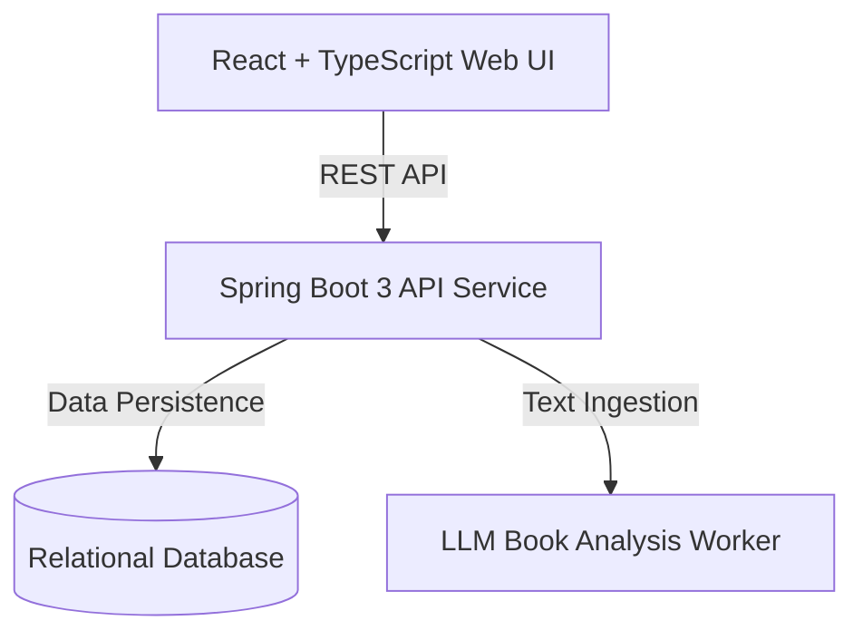

# 📚 Zen Shelf Hub — AI-Powered Virtual Library & Digital Sanctuary

<div align="center">

  

  <h3>📖 Read. Reflect. Discover.</h3>

  <p>
    An AI-powered virtual library platform combining immersive digital reading,
    intelligent book analysis, reading habit analytics, and a personalized digital library experience.
  </p>

[](https://react.dev/)
[](https://spring.io)
[](https://www.docker.com/)
[](LICENSE)

</div>

---

## ✨ Core Pillars

- **🧠 AI-Powered Insights**: Automated summary generation, key quote extraction, and sentiment themes powered by LLMs.
- **📚 Curated Shelves**: Organize reading lists into *Currently Reading*, *Want to Read*, *Completed*, and *Favorites*.
- **📊 Reading Analytics**: Track pages read, reading streaks, genres explored, and completion rates.
- **🐳 Containerized Architecture**: One-click deployment with multi-container Docker Compose.

---

## 🏗️ Architecture



---

## 🚀 Quick Deployment with Docker

```bash
# Clone the repository
git clone https://github.com/TORBIomar/zen-shelf-hub.git
cd zen-shelf-hub

# Start all services with Docker Compose
docker-compose up -d --build
```

Access the frontend at `http://localhost:3000` and the API at `http://localhost:8080`.

---

## 👨‍💻 Author

**Omar Torbi** — Full-Stack Engineer & Software Architect
- 🌐 **Portfolio**: [omartorbi.engineer](https://www.omartorbi.engineer)
- 💼 **LinkedIn**: [linkedin.com/in/omar-torbi](https://www.linkedin.com/in/omar-torbi-b8340933a/)
- 🐙 **GitHub**: [@TORBIomar](https://github.com/TORBIomar)
- ✉️ **Email**: [torbi.dev@outlook.com](mailto:torbi.dev@outlook.com)
